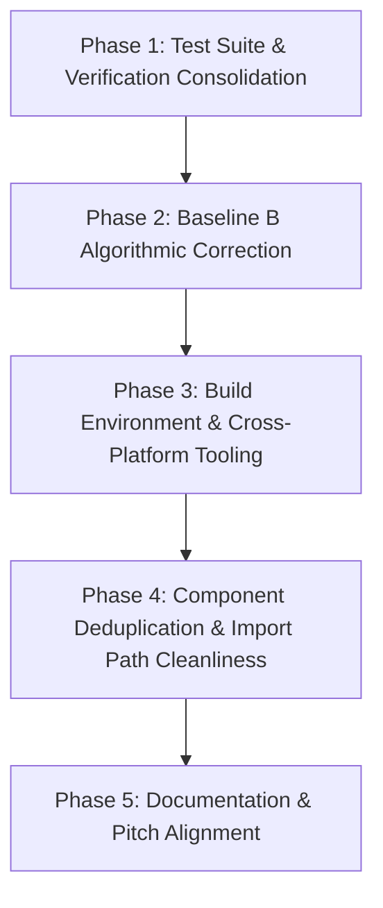

# PEREGRINE — Safe Dependency-Ordered Refactoring Plan

**Disaster-Resilient Broadcast Network · IEEE BTS Hackathon**  
**Document**: Architecture Refactor & Maintenance Roadmap  
**Date**: October 11, 2026  
**Auditor / Architect**: Lead Software Architect  
**Precondition Guarantee**: *No source files were deleted, moved, or modified during the initial audit phase.*

---

## 1. Architectural Strategy & Safety Principles

1. **Non-Destructive Invariant**: Do not delete existing files merely because they appear duplicated or unused. Retain backward-compatible wrappers until all consumers and external references have transitioned.
2. **Deterministic Parity First**: Every refactoring step must preserve the 119 existing passing assertions in `test/model-integrity.test.ts`.
3. **No Fabricated Multipliers**: Preserve the pure model simulation guarantee established in Project Bible v2.1.
4. **Dependency-Ordered Execution**:
   - Model & Test Core first
   - Configuration & Build environment second
   - Component & Import consolidation third
   - Documentation synchronization last

---

## 2. Dependency-Ordered Phased Implementation Plan



---

### Phase 1: Test Suite & Verification Consolidation (Priority: P0)
**Objective**: Connect orphaned test suites and establish a single master test gate that catches all regressions before any source modification.

#### Tasks:
1. **Hook Integration Test Suite into Master Runner**:
   - **Target**: [test/model-integrity.test.ts](file:///d:/projects-2/PEREGRINE/test/model-integrity.test.ts)
   - **Action**: Import `runIntegrationTests` from [test/integration/integration.test.ts](file:///d:/projects-2/PEREGRINE/test/integration/integration.test.ts) and execute it as Step 5 in the master suite.
   - **Verification**: Run `npm test` and verify total pass count increases from 119 to 123 assertions with 0 failures.
2. **Add Headless Test for Optimizer Benchmarking**:
   - **Target**: [test/planner/planner.test.ts](file:///d:/projects-2/PEREGRINE/test/planner/planner.test.ts)
   - **Action**: Add automated test calling `evaluateOptimizerBenchmarking(INITIAL_CONFIG, failures, 50, 0.35, 'S72', 0.5)` to verify that Plan A matches 100% of the theoretical 256-subset global optimum (0.0% optimality gap).
3. **Add Headless Web Crypto Verification**:
   - **Target**: [test/integrity/integrity.test.ts](file:///d:/projects-2/PEREGRINE/test/integrity/integrity.test.ts)
   - **Action**: Add automated ECDSA P-256 signing, SHA-256 tamper detection, and signed withdrawal test in Node using `globalThis.crypto.subtle`.

**Safety Check**:
- Run `npm test` -> Must exit code 0 with >= 125 assertions passed.

---

### Phase 2: Baseline B Algorithmic Correction (Priority: P1)
**Objective**: Eliminate hardcoded static mock values in Baseline B to satisfy Project Bible Sections 0 & 11.2.

#### Tasks:
1. **Implement Dynamic Baseline B Calculation**:
   - **Target**: [src/planner/baselines.ts](file:///d:/projects-2/PEREGRINE/src/planner/baselines.ts)
   - **Defect in Current Code**:
     ```ts
     // Current hardcoded static values
     export function evaluateBaselineNaiveIndependent(): BaselineScoreRecord {
       return { id: 'B', reachS30: 71.5, reachS72: 28.4, lowestVillageOutcome: '15.0%', ... };
     }
     ```
   - **Action**: Calculate Baseline B dynamically from `config` and `failures` by computing naive channel availability assuming independence (ignoring common upstream grid/fibre cuts).
   - **Formula**: Compute theoretical independent union:
     $$R_{\text{naive}} = 1 - \prod_{c \in \text{nominal}} (1 - r_c)$$
     for each village that possesses transmitters, ignoring power and backhaul failures.
2. **Add Unit Test for Baseline B**:
   - **Target**: [test/planner/planner.test.ts](file:///d:/projects-2/PEREGRINE/test/planner/planner.test.ts)
   - **Action**: Validate that Baseline B dynamically changes if channel reach parameters are perturbed, confirming that zero static constants remain.

**Safety Check**:
- Run `npm test` -> Pass.
- Check UI `StressBaselinesPage` -> Baseline B updates dynamically with sensitivity sliders.

---

### Phase 3: Build Environment & Cross-Platform Tooling (Priority: P2)
**Objective**: Fix Vite deprecation warnings and ensure scripts run natively across Windows, Linux, and macOS.

#### Tasks:
1. **Fix Vite `__dirname` Deprecation Warning**:
   - **Target**: [vite.config.ts](file:///d:/projects-2/PEREGRINE/vite.config.ts)
   - **Action**: Update line 11 from:
     ```ts
     alias: { '@': path.resolve(__dirname, '.') }
     ```
     to modern ESM standard:
     ```ts
     alias: { '@': path.resolve(import.meta.dirname, '.') }
     ```
   - **Verification**: Run `npm run build` and ensure the `configLoader: 'native'` warning disappears completely.
2. **Cross-Platform Clean Script**:
   - **Target**: [package.json](file:///d:/projects-2/PEREGRINE/package.json)
   - **Action**: Replace `"clean": "rm -rf dist server.js"` with a cross-platform command or `tsx` clean utility, avoiding shell-specific failure on Windows.

**Safety Check**:
- Run `npm run build` -> Zero warnings, exit code 0.
- Run `npm run lint` -> Zero errors, exit code 0.

---

### Phase 4: Component Deduplication & Import Path Cleanliness (Priority: P3)
**Objective**: Cleanly resolve duplicate components without breaking any existing references.

#### Tasks:
1. **Consolidate `PeregrineLogo` Component**:
   - **Current State**: [src/components/brand/PeregrineLogo.tsx](file:///d:/projects-2/PEREGRINE/src/components/brand/PeregrineLogo.tsx) is a 205-line exact duplicate of [src/components/ui/PeregrineLogo.tsx](file:///d:/projects-2/PEREGRINE/src/components/ui/PeregrineLogo.tsx).
   - **Action**: Keep [src/components/ui/PeregrineLogo.tsx](file:///d:/projects-2/PEREGRINE/src/components/ui/PeregrineLogo.tsx) as the authoritative master implementation. Update `src/components/brand/PeregrineLogo.tsx` to cleanly re-export `PeregrineLogo` from `../ui/PeregrineLogo`, eliminating code duplication while preserving backward compatibility.
2. **Preserve Legacy Component Wrappers**:
   - Maintain the 8 root wrappers in `src/components/` ([AuditPanel.tsx](file:///d:/projects-2/PEREGRINE/src/components/AuditPanel.tsx), [NetworkMapAndGraph.tsx](file:///d:/projects-2/PEREGRINE/src/components/NetworkMapAndGraph.tsx), etc.) as permanent re-export barrels to prevent breaking any third-party or legacy imports.
3. **Root App Entrypoint Clarity**:
   - Document that [src/App.tsx](file:///d:/projects-2/PEREGRINE/src/App.tsx) is the standard external export wrapper for [src/app/App.tsx](file:///d:/projects-2/PEREGRINE/src/app/App.tsx), ensuring both direct imports and root imports resolve seamlessly.

**Safety Check**:
- Run `npm run lint` -> Zero errors.
- Run `npm run build` -> Zero errors.

---

### Phase 5: Documentation & Pitch Deck Alignment (Priority: P3)
**Objective**: Synchronize architectural documentation, README, and presentation materials with the audited reality.

#### Tasks:
1. **Reconcile README Directory Hierarchy**:
   - **Target**: [README.md](file:///d:/projects-2/PEREGRINE/README.md) lines 94–96.
   - **Action**: Annotate `src/hooks/`, `src/services/`, and `src/types/` as planned / modular extension points rather than active physical folders, or create `.gitkeep` placeholders if needed.
2. **Cross-Check Pitch Deck Numerical Values**:
   - Verify that all values in [docs/PITCH_DECK_REVISION_PLAN.md](file:///d:/projects-2/PEREGRINE/docs/PITCH_DECK_REVISION_PLAN.md) match the verified outputs (S30 Cyclone Baseline 54.0%, S30 Planned 71.7%, S72 Baseline 10.6%, Plan A 31.8%, Plan B 25.0%).

---

## 3. Immediate Next Implementation Step

The strictly recommended first operational step is **Phase 1, Task 1**:
> **Wire `runIntegrationTests()` into `test/model-integrity.test.ts`**.  
> This requires a single 3-line import and function call in the test suite, immediately expanding verified test assertions from 119 to 123 without altering any application code.
